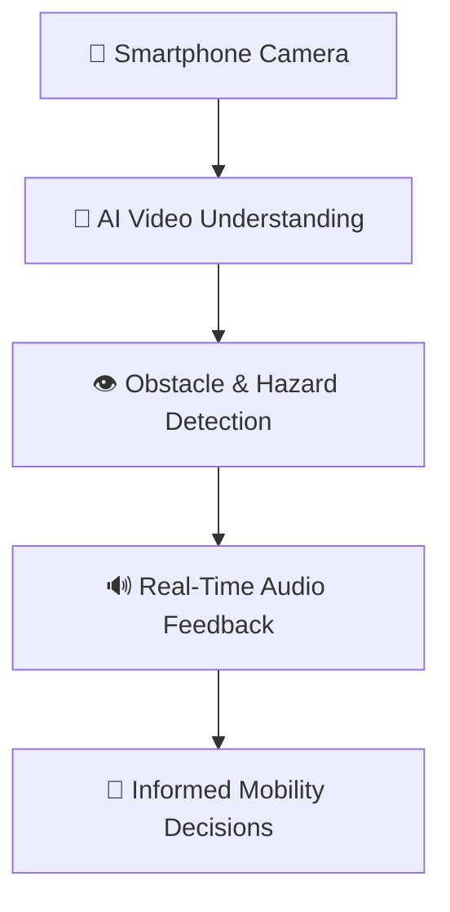

# 🦮 gAIde Dog — Your AI Guide, Right in Your Pocket

### See less. Explore more. Live independently.

**What if your smartphone could help you navigate the world with greater confidence?**

We're building **gAIde Dog**, an affordable, AI-powered mobility companion that uses computer vision to turn everyday smartphones into intelligent assistants for blind and partially sighted people.

---

## 🚧 The Challenge: Independence Shouldn't Be a Luxury

In the UK, more than **2 million people live with sight loss**. For many, everyday activities like walking to the shops, navigating crowded pavements, or avoiding unexpected obstacles can present significant challenges.

| 👁️ 2 Million+ | 🦮 £102,000 | 💼 27% |
|:---:|:---:|:---:|
| People living with sight loss in the UK | Approximate lifetime cost of supporting a guide dog | Employment rate cited for working-age blind and partially sighted people |

Guide dogs offer life-changing support, but they require considerable resources. Emerging smart glasses and assistive technologies can also be expensive and may not fully address users' everyday mobility needs.

**The problem isn't a lack of technology. It's making the right technology accessible to everyone.**

---

## 💡 Meet gAIde Dog: AI That Helps You Take the Next Step

**No expensive smart glasses. No specialised hardware. Just a smartphone and AI.**

gAIde Dog uses computer vision and real-time video analysis to identify potential obstacles and provide short, actionable audio prompts.

Our prototype explores three key capabilities:

### 👁️ 1. Understand Your Surroundings

Analyse live smartphone camera footage to identify potential obstacles, pedestrians, and hazards along the user's path.

### 🔊 2. Turn Vision Into Action

Convert visual information into clear, timely audio instructions:

- 🛑 **"Stop!"** — Potential obstacle ahead.
- ⏳ **"Wait!"** — Possible hazard detected.
- 🚶 **"Proceed with caution."** — Continue while remaining alert.

### 📱 3. Make Accessibility Affordable

Build on hardware people already own, reducing dependence on expensive specialised devices.

---

## ⚙️ How gAIde Dog Works

**Camera → AI → Awareness → Action**

Instead of overwhelming users with everything the camera sees, gAIde Dog aims to communicate **what matters, when it matters**.

---

## 🌍 Our Vision: A More Accessible World, One Step at a Time

We don't want to replace guide dogs, white canes, or professional mobility training.

**We want to make intelligent assistance more accessible.**

gAIde Dog is an early-stage prototype exploring how AI can complement trusted mobility tools, improve environmental awareness, and help people with sight loss explore the outside world with greater confidence.

Our long-term ambition is to develop gAIde Dog alongside blind and partially sighted users, with accessibility, reliability, and safety at the centre of its design.

### 🦮 gAIde Dog
**More awareness. More confidence. More independence.**

*Because everyone deserves the freedom to explore.*
